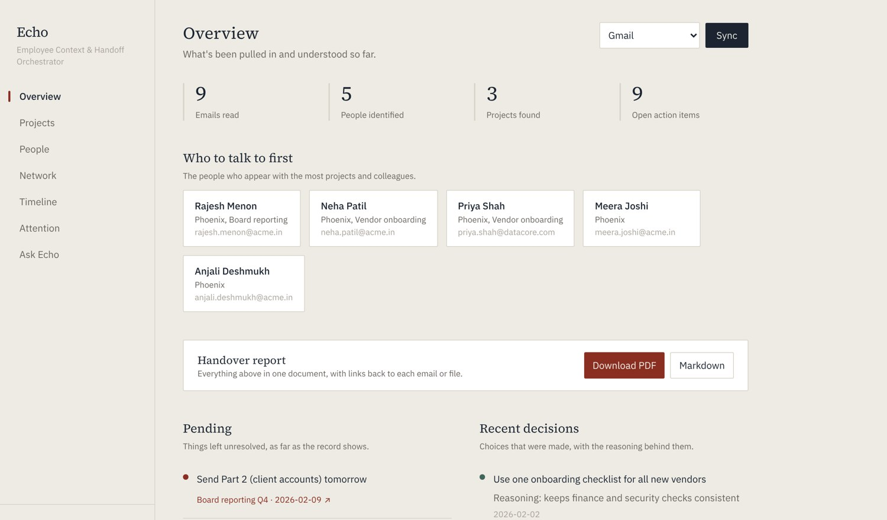
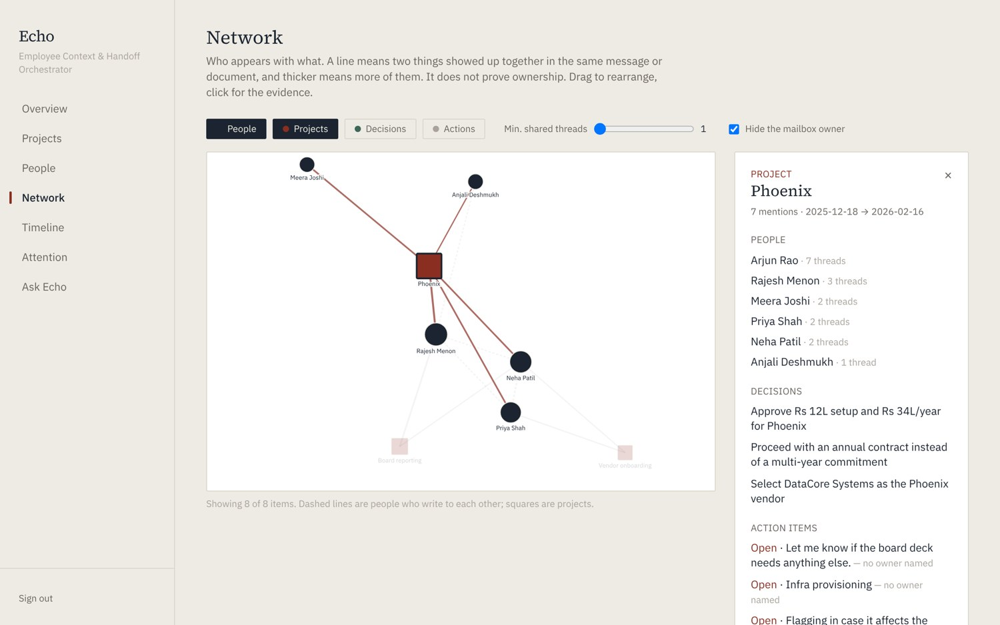
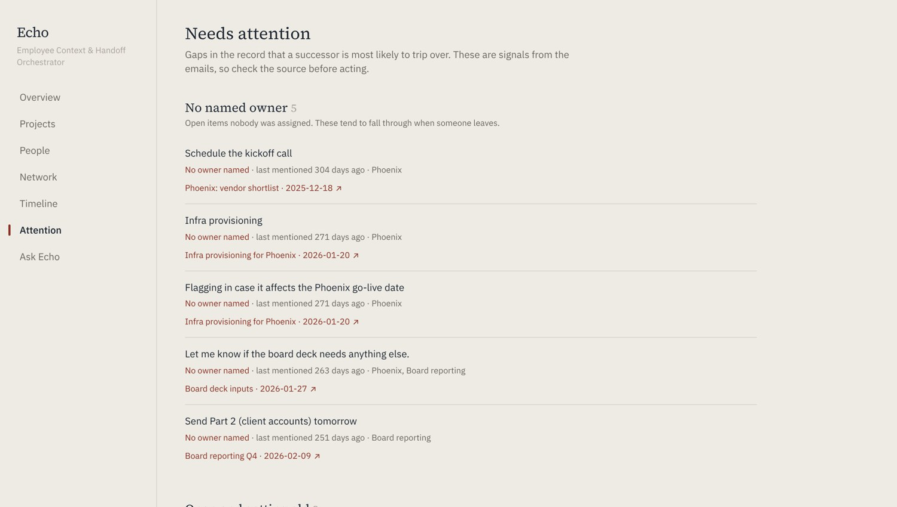
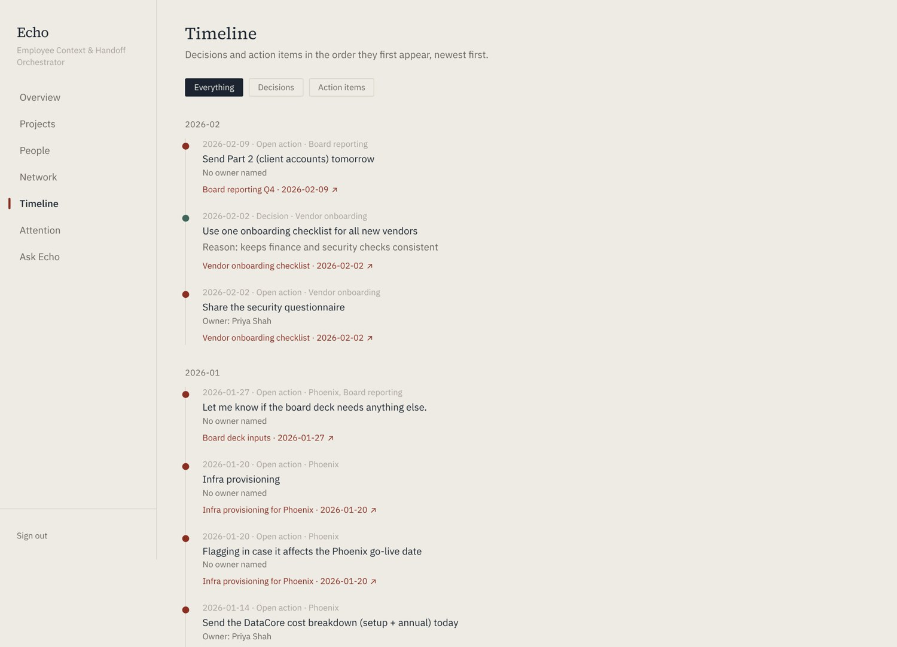
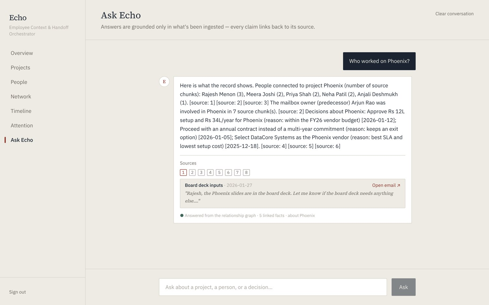
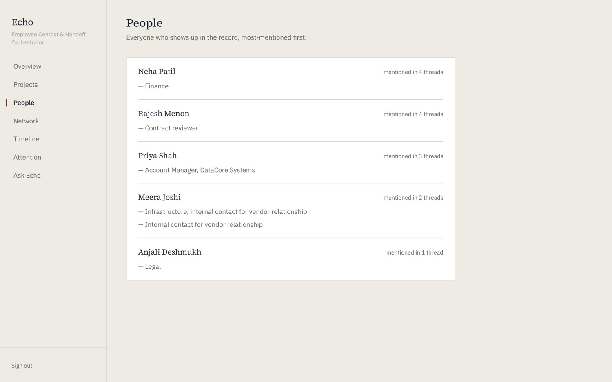
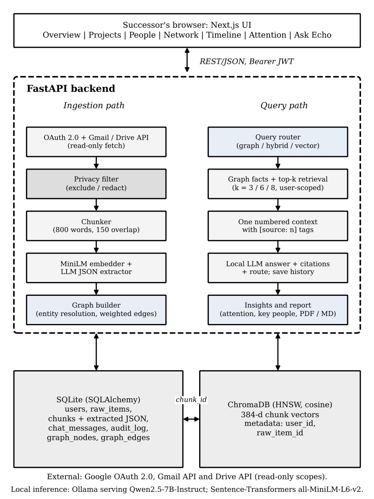

<div align="center">

# ECHO

### Employee Context & Handoff Orchestrator

**Give a successor the full story of their predecessor's work: who was involved, what was decided and why, what is still open, with every claim linked back to the original email or document.**


</div>

---

## The problem

When someone leaves a team, what they knew leaves with them. It lives in thousands of emails and shared documents: which vendor was chosen and why, who signed off on the budget, which tasks nobody picked up. The successor is left to search through an inbox keyword by keyword.

## What ECHO does

ECHO reads a predecessor's **Gmail** and **Google Drive** (read-only), extracts **people, projects, decisions (with reasoning) and action items**, links them into a **knowledge graph**, and gives the successor:

| | |
|---|---|
| **Dashboard** | Overview, People and Projects pages built from the extracted record |
| **Citation-grounded chat** | Ask in plain English; every answer cites numbered sources that link to the original email or document |
| **Query router** | Relationship questions ("who worked on Atlas?") use the graph; explanatory ones ("why did we pick Vendor B?") also use document search |
| **Network view** | An interactive graph of people and projects, with an evidence panel for each node |
| **Who to talk to first** | People ranked by how many projects and colleagues they appear with |
| **Attention report** | Open tasks with no owner, tasks left open too long, projects only one person knows about |
| **Timeline** | Decisions and action items in date order |
| **Handover report** | The whole record as a PDF or Markdown file, with source links |
| **Privacy first** | Sensitive items are filtered *before* anything is stored, embedded or sent to a model, and the model runs **locally** |

> No cloud LLM and no API key is needed. Inference runs on your machine through [Ollama](https://ollama.com).

## Screenshots

The screenshots below were captured from the running app on a small sample mailbox (a vendor-onboarding project called "Phoenix").

<p align="center">
  
  
</p>
<p align="center">
  
  
</p>
<p align="center">
  
  
</p>

*The chat capture used a stand-in for the language model because no local model was running; with Ollama running, the wording of answers comes from Qwen2.5.*

## Architecture

<p align="center"></p>

Three tiers:

- **Presentation:** Next.js 14, React, TypeScript, Tailwind CSS
- **Application:** FastAPI with Google OAuth 2.0 and JWT sessions
- **Storage:** SQLite for records and the graph, ChromaDB for vector search

The full data flow is in [`docs/data-flow.png`](docs/data-flow.png).

### How it works

**Ingestion** (per synced item):
`Gmail / Drive (read-only)` → `privacy filter` → `chunk (800 words, 150 overlap)` → `embed (all-MiniLM-L6-v2, 384-d)` → `extract people / projects / decisions / actions as JSON (Qwen2.5-7B)` → `store in SQLite + ChromaDB` → `rebuild the graph`

**Knowledge graph** (deterministic, no model calls, rebuilt after each sync):

- Nodes: person, project, decision, action.
- Relations: `WORKS_ON`, `COLLABORATES_WITH`, `ABOUT`, `INVOLVES`, `OWNS`.
- An edge's weight is the number of distinct chunks where both ends appear together. Each edge keeps the ids of its supporting chunks as evidence.
- **Entity resolution is conservative.** "Priya", "Priya Sharma" and "Sharma, Priya" become one person. Two different people called "Sam" stay separate, because a bare first name merges only when exactly one candidate exists, fuzzy matches need similarity of at least 0.92, and conflicting email addresses block a merge. Automated senders (no-reply, etc.) never become people.
- Near-identical decisions and tasks (token-set Jaccard of at least 0.70) are merged.

**Question answering:**
`question` → `router (graph / hybrid / vector)` → `graph facts + top-k chunks (k = 3 / 6 / 8, user-scoped)` → `one numbered context, [source: N]` → `local LLM` → `answer + links + routing note` → `saved to chat history`

## Tech stack

| Layer | Technology |
|---|---|
| Frontend | Next.js 14, React 18, TypeScript, Tailwind CSS |
| Backend | Python, FastAPI, SQLAlchemy 2.0, Pydantic |
| Auth | Google OAuth 2.0 (Gmail + Drive read-only), JWT |
| Relational + graph store | SQLite |
| Vector store | ChromaDB (HNSW, cosine) |
| Embeddings | sentence-transformers `all-MiniLM-L6-v2` |
| Local LLM | Ollama serving `qwen2.5:7b-instruct` |
| Reports | ReportLab (PDF) |
| Tests | pytest |

## Project structure

```
.
├── backend/
│   ├── app/
│   │   ├── main.py              # FastAPI app, routers, CORS
│   │   ├── config.py            # settings from .env
│   │   ├── auth/                # Google OAuth + session tokens
│   │   ├── ingestion/           # Gmail & Drive connectors, privacy filter, chunking, sync job
│   │   ├── ai/                  # embeddings, extraction, query router, RAG pipeline, chat, prompts
│   │   ├── graph/               # entity resolution, graph builder, queries, insights
│   │   ├── reports/             # handover report (PDF / Markdown)
│   │   ├── api/                 # chat, dashboard, graph/insights, ingestion, report routes
│   │   ├── db/                  # SQLAlchemy models, session, ChromaDB store
│   │   └── utils/               # source links, date helpers
│   ├── scripts/test_local_llm.py
│   ├── tests/                   # 65 automated tests
│   ├── requirements.txt
│   └── .env.example
├── frontend/
│   ├── app/                     # pages: dashboard, projects, people, network, timeline, attention, chat
│   ├── components/              # shared, dashboard, network, chat components
│   └── lib/                     # API client, auth, hooks, graph layout
└── docs/                        # diagrams and screenshots
```

## Getting started

### Prerequisites

- Python 3.11+ and Node.js 18+
- [Ollama](https://ollama.com) with the model pulled:
  ```bash
  ollama pull qwen2.5:7b-instruct      # use phi3.5 if you have under ~8 GB free RAM
  ```
- A Google Cloud project with the **Gmail API** and **Drive API** enabled and an OAuth client (type: Web application) with the redirect URI `http://localhost:8000/auth/callback`. While the consent screen is in *Testing* mode, add your account as a test user.

No Docker and no database server are needed: SQLite and ChromaDB are local files.

### 1. Backend

```bash
cd backend
python3 -m venv venv
source venv/bin/activate              # Windows: venv\Scripts\activate
pip install -r requirements.txt
cp .env.example .env                  # then fill in the values below
python scripts/test_local_llm.py      # optional: checks Ollama responds
uvicorn app.main:app --reload --port 8000
```

Open <http://localhost:8000/health> (should return `{"status": "ok"}`) and <http://localhost:8000/docs> for the interactive API docs.

### 2. Frontend

```bash
cd frontend
npm install
npm run dev
```

Open <http://localhost:3000>, sign in with Google, then press **Sync** on the Overview page (choose Gmail, Drive documents, or both).

If your backend is not at `http://localhost:8000`, set `NEXT_PUBLIC_API_BASE_URL` in `frontend/.env.local`.

### Configuration (`backend/.env`)

| Variable | Description | Default |
|---|---|---|
| `GOOGLE_CLIENT_ID` | OAuth client id | required |
| `GOOGLE_CLIENT_SECRET` | OAuth client secret | required |
| `GOOGLE_REDIRECT_URI` | Must match the Google console | `http://localhost:8000/auth/callback` |
| `SECRET_KEY` | Signs session tokens. Generate with `python3 -c "import secrets; print(secrets.token_hex(32))"` | required |
| `DATABASE_URL` | SQLite file | `sqlite:///./kt_dashboard.db` |
| `CHROMA_PERSIST_DIR` | Vector index folder | `./chroma_db` |
| `OLLAMA_BASE_URL` | Ollama server | `http://localhost:11434` |
| `OLLAMA_MODEL` | Local model name | `qwen2.5:7b-instruct` |
| `FRONTEND_URL` | Allowed CORS origin | `http://localhost:3000` |

## API overview

All routes except `/auth/*` and `/health` need `Authorization: Bearer <session token>`.

| Method | Route | Purpose |
|---|---|---|
| GET | `/auth/login`, `/auth/callback` | Google sign-in |
| POST | `/ingestion/sync?source=gmail\|drive\|all` | Ingest new items and rebuild the graph |
| GET | `/dashboard/summary` | Overview, people, projects, decisions, pending actions |
| GET | `/graph/network` | Graph view with filters (`types`, `min_weight`, `hide_owner`, `limit`, `focus`) |
| GET | `/graph/node/{id}` | A node with its connections and evidence |
| POST | `/graph/rebuild` | Rebuild the graph from stored extractions |
| GET | `/insights/attention`, `/insights/key-people`, `/insights/timeline` | Successor guidance |
| GET | `/reports/handover?format=pdf\|md` | Download the handover report |
| POST | `/chat/ask` | Ask a question |
| GET / DELETE | `/chat/history` | Read or clear the saved conversation |

## Testing

```bash
cd backend
pip install pytest
python -m pytest -q
```

65 tests run without a language model, Google account or network access, using a deliberately messy sample mailbox. They cover entity resolution, graph construction, the query router, source numbering, per-user isolation, the report, and ingestion with a failing source.

These tests check that the system behaves as designed. They do **not** measure how accurate the language model's extraction or answers are on real mailboxes.

## Privacy and security

- Google access is **read-only** (Gmail and Drive scopes).
- Items matching sensitive subjects or patterns (for example performance reviews, medical topics, salary mentions, SSN-like and card-like numbers) are **excluded or redacted before** storage, embedding or extraction. This is defense in depth, not a guarantee: the filter only catches what its rules describe, so a consent-and-review step by the departing employee is still recommended.
- The language model and embeddings run **locally**; no email content is sent to a third-party AI service.
- Every query, graph view and report is scoped to the signed-in user.
- Answers are instructed to use only the supplied sources and to say when they are insufficient. Still, connections in the graph mean "appeared together", not "owns", so check the linked source before acting on anything important.

## Limitations and roadmap

- Sync runs inside a single request, which suits a few dozen items; full-mailbox volumes need a background worker with progress reporting.
- Chat is one conversation thread per user.
- Drive ingestion skips Sheets, PDFs and Office files.
- Extraction quality depends on the local model; a larger annotated evaluation is still to be done.
- Planned: employee consent and review workflow, more sources (calendar, chat, meeting notes), multi-hop graph questions, multiple chat threads.

## License

This project is released under the [MIT License](LICENSE).
